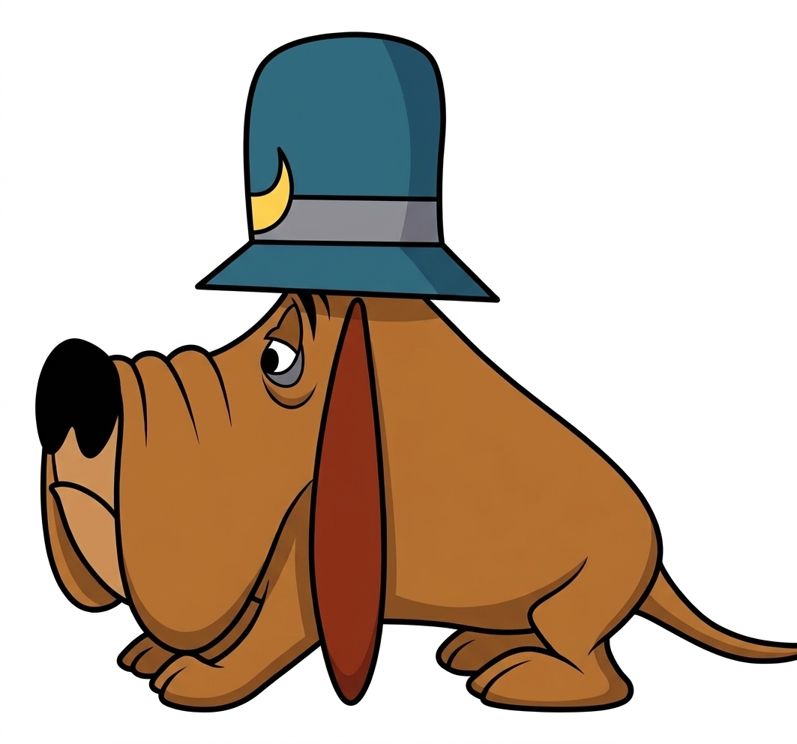

<h1>
  <picture>
    <source media="(prefers-color-scheme: dark)" srcset="docs/images/galantelab-strongnose_logo_dark.jpg">
    
  </picture>
</h1>

# Strongnose
🐕 Sniffing out and classifying structural variations from Sniffles outputs
