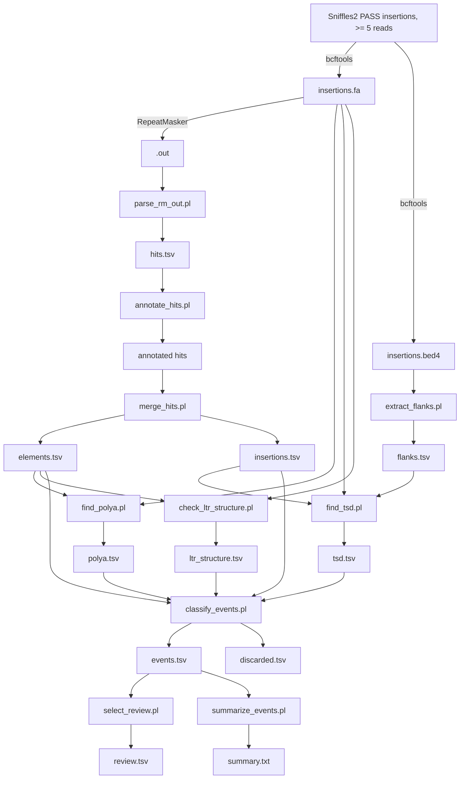

# Strongnose: detection and classification of new mobile element insertions from Oxford Nanopore data

Status: working pipeline, tested on one human ONT sample (hg38). Every threshold is a starting value that has not been
validated against a truth set. Section 9 lists what remains to be done.

Every fixed value the tables can contain (confidence levels, gates, flags, discard reasons, statuses) is listed in
[TAGS.md](TAGS.md).

## 1. Purpose and scope

Strongnose takes insertion calls from Sniffles2 and decides which of them are new insertions of human mobile elements.
It reports a confidence level for each call and keeps the evidence behind it, so that a call can be checked by hand.

- Species: human only.
- Data: germline and somatic callsets; long reads (Oxford Nanopore) mapped with minimap2; calls from Sniffles2.
- Elements: Alu, L1, SVA and HERVK (HML-2) proviruses. Solo LTR5_Hs insertions are supported but disabled by default.
- Reference: T2T is preferred. hg38 is supported, and the pipeline reports reference-dependent problems as flags
  instead of dropping events silently (section 8).
- Implementation: small Perl scripts (namespace `Strongnose`, scripts in `bin/`, shared code in `lib/Strongnose/`),
  one decision per script, tab-separated tables between steps. Nextflow wraps the scripts; the scripts do not read the
  Nextflow configuration, they take GNU-style options (`--polya-max-gap 10`).

## 2. Inputs

| Input | How it is made |
|---|---|
| `insertions.fa` | inserted sequences of the PASS insertions, extracted from the VCF with bcftools. Only calls supported by at least 5 long reads are kept (filter applied before this pipeline). The first base of each sequence is the VCF anchor base. |
| `insertions.bed4` | one line per insertion; `bed_end` is the VCF `POS` (the reference base before the insertion) and the 4th column is the insertion ID |
| RepeatMasker `.out` | RepeatMasker run on `insertions.fa` |
| reference FASTA + `.fai` | the reference used for mapping |
| `assets/subfamilies.tsv` | repeat name, group and age tier (section 4) |
| `assets/class_profiles.tsv` | one row per event profile: rule, evidence, gates (section 4) |

## 3. Pipeline overview



| Script | Decision it makes | Output |
|---|---|---|
| `parse_rm_out.pl` | turns the `.out` into one row per hit, keeping consensus coordinates and the `*` flag | `hits.tsv` |
| `annotate_hits.pl` | repeat name, group, age tier, young or not per profile | annotated hits |
| `merge_hits.pl` | which hits form one element; which element is primary | `elements.tsv`, `insertions.tsv` |
| `find_polya.pl` | is there a poly-A tail at the 3' end of each element | `polya.tsv` |
| `extract_flanks.pl` | reference sequence around each insertion point | `flanks.tsv` |
| `find_tsd.pl` | is there a target site duplication | `tsd.tsv` |
| `check_ltr_structure.pl` | LTR-internal-LTR layout and LTR identity (HERVK); solo LTR | `ltr_structure.tsv` |
| `classify_events.pl` | gates, evidence, confidence, flags; what is dropped and why | `events.tsv`, `discarded.tsv` |
| `select_review.pl` | list of events for manual review, with what to check | `review.tsv` |
| `summarize_events.pl` | quantiles and histograms used to calibrate the profiles | `summary.txt` |

Typical run order (options not shown; see `conf/mobile_dna.config` and `--help` of each script):

```
perl bin/parse_rm_out.pl  --bed insertions.bed4 insertions.fa.out > hits.tsv
perl bin/annotate_hits.pl --subfamilies assets/subfamilies.tsv --profiles assets/class_profiles.tsv hits.tsv > annotated.tsv
perl bin/merge_hits.pl    --profiles assets/class_profiles.tsv --insertions-out insertions.tsv annotated.tsv > elements.tsv
perl bin/find_polya.pl    --fasta insertions.fa elements.tsv > polya.tsv
perl bin/extract_flanks.pl --reference ref.fa insertions.bed4 > flanks.tsv
perl bin/find_tsd.pl      --fasta insertions.fa --flanks flanks.tsv insertions.tsv > tsd.tsv
perl bin/check_ltr_structure.pl --profiles assets/class_profiles.tsv --elements elements.tsv --fasta insertions.fa > ltr_structure.tsv
perl bin/classify_events.pl --profiles assets/class_profiles.tsv --elements elements.tsv --insertions insertions.tsv \
     --polya polya.tsv --tsd tsd.tsv --structure ltr_structure.tsv --bed insertions.bed4 --discarded-out discarded.tsv > events.tsv
```

`--fasta` of `check_ltr_structure.pl` must be the insertion FASTA, never the reference.

## 4. Data files

### subfamilies.tsv

Columns: `repeat_name group tier rm_family max_div notes`. The repeat name is the exact RepeatMasker name. The tier says
how young a subfamily is, independently of any one copy:

- `active`: subfamilies with known recent activity (AluYa5, AluYb8, AluYb9, L1HS, SVA_E/F/F1, LTR5_Hs)
- `young`: other AluY subfamilies, L1PA2 to L1PA6, SVA_D
- `intermediate`: AluS, L1PA7/8, SVA_A to C, LTR5A/B
- `old`: AluJ and monomers, LTR5
- `internal`: internal region of a multi-part element (HERVK-int); its age comes from its LTRs
- `generic`: the name gives no subfamily information (plain `Alu`); judged by divergence only

Names that are not listed default to `old`. The table was built from the names observed in the first RepeatMasker run
and cross-checked against a Repbase list; a full clean-up against Repbase and Dfam is planned for the end of the work.

### class_profiles.tsv

One row per event profile (Alu, L1, SVA, HERVK_provirus, HERVK_solo_ltr). Main columns:

| Column | Meaning |
|---|---|
| `rm_family_match` | regex on the RepeatMasker class/family; only matching hits can become candidate elements (allow-list) |
| `rule` | `single_element`, `ltr_int_ltr` or `solo_ltr` |
| `young_tiers` | tiers that count as young for this profile |
| `evidence` | evidence items besides age: `polya`, `tsd`, `structure` |
| `tsd_min`, `tsd_max`, `tsd_min_identity` | TSD length range and identity that count as evidence |
| `min_cov`, `len_min`, `len_max` | gates: fraction of the insertion covered by the element; insertion length |
| `rule_params` | `key=value` list: `max_3end_left`, `max_strand_switch`, `absorb_inside_span`, `join_group_elements`, `join_gap`, `ltr_names`, `internal_names`, `ltr_len`, `internal_min`, `same_orientation`, `ltr_min_identity` |

## 5. Methods by step

### 5.1 parse_rm_out.pl

Reads the RepeatMasker `.out` and writes one row per hit. For hits on the complement strand (`C`), RepeatMasker
prints `(left) end begin`; the parser maps these to `c_start`, `c_end` and `c_left`, where `c_left` is the number of
consensus bases after the end of the match, that is, on the 3' side. The ID column and the `*` flag (hit overlapped by a
higher-scoring hit) are kept. A self-check compares the consensus length implied by each repeat across hits and
reports inconsistencies; Simple_repeat and Low_complexity are exempt because their consensus length varies.

### 5.2 annotate_hits.pl

Normalises repeat names (case, positional suffixes such as `_5`/`_3end`, `-int` versus `I`), looks them up in
`subfamilies.tsv`, and attaches group and tier. A hit is young for a profile when its tier is in the profile's
`young_tiers` and its corrected divergence is under the ceiling of the tier (`max_div_active` 8, `max_div_young` 10,
`max_div_generic` 6). The corrected divergence is the `perc div` of the `.out` reduced by `ont_div_correction`
(percentage points, floor 0; 0.0 by default, to be calibrated).

### 5.3 merge_hits.pl

RepeatMasker splits one element into several hits, and an element inserted into an older one is split around it.
The script builds elements in three passes:

1. Overlap resolution: hits are taken in score order; a hit overlapping accepted hits by more than
   `overlap_max_frac` (0.20) of its length is kept only as an alternative. Hits flagged `*` are skipped.
2. Joining: fragments with the same RepeatMasker ID, then fragments within `merge_max_gap` (100 bp) of each other, are
   joined when the name, strand and profile agree and the consensus coordinates keep their order (tolerance
   `merge_cons_tolerance`, 20 bp).
3. Absorption (SVA): hits of the classes listed in `absorb_inside_span` (Simple_repeat, Low_complexity, SINE/Alu)
   that lie inside the span of an SVA element count as part of it.

The primary element of an insertion is the one that covers the most bases (at least `min_primary_element_len`,
100 bp). The script also reports the fractions of the insertion covered by tandem repeats, satellites and unknown
sequence, which `classify_events.pl` uses to drop artefacts.

### 5.4 find_polya.pl

For each element the tail is searched on the 3' side, from `polya_inside_margin` (20) bp before the element end to
`polya_search_window` (40) bp after it. On minus-strand elements the search runs on the reverse complement. The tail
is the maximum-scoring segment under a scoring scheme in which an A scores +1 and any other base scores
`-purity/(1-purity)`, so a segment with an A fraction of at least `polya_min_purity` (0.85) cannot score below zero. This
tolerates the substitutions and indels that ONT makes in homopolymers, so no exact run is required. The tail must be at
least `polya_min_len` (10) bp and start at most `polya_max_gap` (10) bp after the element end. The table reports the
tail in insertion coordinates and the number of bases after it (`bases_after_tail`); the tail sequence is shown in
element orientation (as A).

### 5.5 extract_flanks.pl and find_tsd.pl

`extract_flanks.pl` reads, through the `.fai` index, a window of `flank_size` (80) bp on each side of the insertion point
`P` (`bed_end`).

`find_tsd.pl` rests on one observation: let `S` be the reference left flank, the insertion and the reference right flank,
and `n` the insertion length. When the insertion is flanked by a TSD, `S[i] = S[i+n]` along a run that touches the
junction. The script scans the runs next to the junction, tries the junction at `tsd_pos_window` (2) bp to each side
(Sniffles positions are imprecise) and removes the anchor base automatically when the first insertion base equals the
reference base at `P` (detected over the whole table).

Among the candidate runs the script keeps the most significant one, not the highest-scoring, because a long TSD with two
ONT substitutions would otherwise lose to a shorter exact one. The significance is a heuristic adjusted p-value,
`P(Binomial(k, 0.30) >= m) * (k+1) * (2w+1)`, for `m` matching bases of `k`, where `w` is the junction window. It is **not
calibrated**; the 0.30 chance of a base match is too low for GC-rich or low-complexity flanks. A run that reaches
`tsd_scan_max` (40) is flagged `tsd_capped`: the insertion duplicates the neighbouring reference, as in a tandem
duplication or a length change of an existing repeat.

The false-positive rate is measured, not assumed. With `--decoy`, each insertion is compared with the flank of the next
insertion in the table, so any TSD found is by construction chance. On the first sample, 49 of 3019 insertions (1.6%) gave a
decoy TSD with `tsd_pos_window 2` and `tsd_max_pvalue 0.01`, against 2205 TSDs found in the real run. Short TSDs are the
weak part: 5-9 bp gave 103 real against 14 decoy hits (about 14% chance), 10 bp or longer 2102 against 35. In the real
run, 91% of the TSDs sit at junction shift 0.

### 5.6 check_ltr_structure.pl

For profiles with rule `ltr_int_ltr` (HERVK provirus) it looks for two LTRs of the profile (names in `ltr_names`,
length in `ltr_len`), the first before the second without overlap, on the same strand (`same_orientation`), with at least
`internal_min` bp between them. Of all pairs the one with the largest outer span is kept. The two LTRs are aligned (banded
global alignment, in element orientation) and `ltr_identity` is the fraction of matching alignment columns. The internal
region may be unannotated; internal-region elements on the opposite strand of the LTRs over more than 20% of the stretch
fail the orientation check. The structure is valid when the pair exists, the internal length and orientation are
correct and `ltr_identity >= ltr_min_identity` (0.95). Young proviruses have near-identical LTRs, so a low identity argues
against a recent insertion.

For profiles with rule `solo_ltr` the script takes the longest LTR of the profile; the structure is valid when its length
is inside the range, no internal-region element covers more than 20% of the insertion and no second LTR is present.
Provirus-shaped insertions are marked `not_solo` and ignored.

### 5.7 classify_events.pl

Every insertion ends in exactly one of two tables.

Dropped (`discarded.tsv`, with the reason): `no_repeat_hit` (no RepeatMasker hit, listed from the BED), `no_candidate_element`,
`tandem_repeat`, `satellite`, `unknown_sequence` (the covered fractions exceed the limits), `no_primary_element`,
`no_enabled_profile`, `below_min_confidence`.

For the others, the primary element is judged by each of its enabled profiles and the best result is kept.

Gates (any failure caps the confidence at low): insertion length (`len_min`, `len_max`); coverage by the element
(`min_cov`); 3' end present (`max_3end_left`, from `c_left`); strand switches (`max_strand_switch`). For profiles
with `join_group_elements=yes` (SVA) the coverage counts all elements of the same group and strand, because RepeatMasker
splits one SVA among subfamily names (SVA_F, SVA_B, SVA_C), and adjacent Alu, Simple_repeat and Low_complexity pieces that
lie inside the group span or on its 5' side; a piece after the 3' end is another element.

Evidence: `polya` counts when a tail was found, the 3' end is present and at most `polya_max_after_tail` (50) bp follow
it; `tsd` counts when a TSD was found, is not capped, has a length inside the profile range and the identity required by
the profile; `structure` counts when `check_ltr_structure.pl` found a valid structure.

Confidence:

| Level | Condition |
|---|---|
| `high` | young, no gate failed, all evidence items present |
| `probable` | young, no gate failed, some but not all evidence items |
| `low` | everything else |

The poly-A and TSD evidence carry the same weight. In the first sample poly-A was found at least as often as the TSD
(Alu 96% against 90%, L1 85% against 61% among young elements that passed every gate), so there is no sensitivity argument
for weighting the TSD above it.

Flags (informational, they do not change the confidence): `fragment_no_3end` (the 3' gate failed),
`tandem_dup_of_flank` (the TSD run reached the scan limit), `element_after_3end` (another element of 100 bp or more,
not a piece of the same group, lies after the 3' end of the primary: 3' transduction, composite insertion or a second event).

`events.tsv` keeps the evidence behind each call (tail length and purity, TSD length, identity and p-value, divergence,
coverage, gates failed, other elements in the insertion).

### 5.8 select_review.pl and summarize_events.pl

`select_review.pl` writes the list for manual review: samples of the high and probable calls of each profile, every
event of the categories that raise a rule question (SVA with an element after the 3' end, SVA whose 3' gate failed despite
poly-A and TSD, young events rejected by a gate despite both evidence, TSD run at the scan limit), calibration samples
(high Alus with the highest divergence, AluS and older with both evidence, high calls with a TSD of 9 bp or less) and
samples of the dropped insertions by reason, to estimate what the pipeline misses. Each row has an IGV locus, the reason it
is listed, a checklist of what to look at (including what the pipeline cannot see: read support, reference context,
subfamily diagnostic positions) and empty columns for the verdict. Optional extra columns (read support, allele fraction)
can be joined from the VCF.

`summarize_events.pl` prints the confidence counts, gate and flag counts, the poly-A x TSD cross table and, for the
reference set of young events with both poly-A and TSD found, the quantiles of length, coverage, divergence, `c_left`,
TSD and tail. The divergence histograms per tier are the basis for `ont_div_correction` and the ceilings.
Poly-A and TSD do not depend on the quantities being calibrated, so the reference set is a fair guide to the limits.

## 6. Results on the first sample

One human sample sequenced with ONT, mapped to hg38, 10,452 PASS insertions with at least 5 supporting reads.

| | Count |
|---|---|
| insertions | 10,452 |
| no RepeatMasker hit | 3,230 |
| RepeatMasker hit, but no candidate element | 4,203 |
| candidate element, but no primary element (shorter than 100 bp) | 371 |
| dropped as tandem repeat / satellite | 16 / 5 |
| events | 2,627 |

| Profile | high | probable | low |
|---|---|---|---|
| Alu | 1,100 | 187 | 657 |
| L1 | 47 | 45 | 257 |
| SVA | 20 | 5 | 290 |
| HERVK provirus | 0 | 0 | 19 |

About 70% of the Sniffles insertions carry no recognisable mobile element (expansions of tandem repeats and other
sequence are common at this support). No complete HML-2 provirus was found in this sample. Three near-full-length
LTR5_Hs insertions (about 975 bp) are solo-LTR candidates. For orientation: as far as I know, long-read studies report on
the order of a thousand non-reference Alu insertions per genome, so the Alu count is plausible, but none of these
counts has been validated against a truth set.

TSD detection: of the 3,019 insertions with a candidate element a TSD was found in 2,205 (713 of them 30 bp or longer, 505
at the scan limit); the decoy run found 49.

## 7. What the first sample taught us (decisions)

- **TSD windows and thresholds.** With a junction window of 5 and p 0.05 the decoy false-positive rate was 3.0%; window
  2 and p 0.01 halve it (1.6%) and lose 21 of 2,226 real TSDs, whose shifts were at chance level. Real TSDs sit at shift 0
  or +-1.
- **TSD range per profile.** Very long runs are not a problem for the classifier, because the profile's `tsd_min` and `tsd_max` exclude them
  and `tsd_capped` marks them. A TSD of 5 bp cannot reach `tsd_max_pvalue` 0.01 (an exact 7 bp run is the shortest that
  can), so HERVK, whose TSD is 4-6 bp, uses the structure as its evidence and reports the TSD without counting it.
- **VNTR length changes inside reference SVAs.** Many SVA insertions of 100-800 bp match the same position of the
  consensus (`c_left` about 520), without a 3' end and often with a capped TSD. They are length changes of existing SVAs,
  not new insertions, and the 3' gate (`max_3end_left` 100) correctly leaves them low. The `c_left` of SVAs with poly-A and TSD
  falls between 0 and 20 apart from two events (253 and 339), so the limit sits in a clear gap.
- **SVA split among subfamily names.** Six SVAs with both evidence failed the coverage gate (0.38-0.47) because the rest of
  the insertion was annotated as SVA_B, SVA_C and AluSx3. The coverage now counts same-group pieces and adjacent pieces on the 5' side. After the
  change, a full-length AluSx3 with its own tail lying after the SVA's poly-A turned out not to be a component of the SVA
  (three events); it raises `element_after_3end` for manual review (3' transduction, composite or second event).
- **Poly-A and ONT.** ONT is known to struggle with homopolymers, but poly-A was detected at least as often as the TSD, and
  the tail search is tolerant of errors (purity instead of an exact run), so the two evidence items keep equal weight.
- **Order of the decoy.** `--decoy` is a calibration tool, not a filter: run it for a new dataset or reference, or after changing the TSD options.

## 8. hg38 and T2T

T2T resolves regions that are complex in hg38 (centromeres, segmental duplications, gaps); in hg38 these regions can
produce RepeatMasker hits that disappear on T2T. Strongnose should therefore flag, not hide, reference-dependent problems:

- Planned: an optional BED of problem regions per reference (gaps, centromere models, segmental duplications); insertions in it get a
  flag and a confidence cap at probable. Empty for T2T.
- Planned: a check of whether the insertion point lies inside a reference repeat of the same family (a length change of
  an existing element). The current pipeline detects the typical case from the insertion sequence alone (3' end missing,
  capped TSD) and flags it, but cannot see the reference.
- Reference annotation, when needed, will be produced with the same RepeatMasker version and library as the insertions and
  stored as a versioned asset per reference.
- `find_tsd.pl` should treat flanks that contain N as a separate status (to be checked).

## 9. Limitations and next steps

- No truth set: all thresholds are heuristics from one sample. Planned validation: (1) manual review of the list from
  `select_review.pl`, which gives precision per confidence level and category; (2) simulation of true and false positives
  (known insertions with chosen TSD, poly-A and divergence, plus tandem expansions, random sequence and old elements) to
  estimate recall and precision per tier; (3) comparison with known polymorphic insertions for germline calls.
- Age: `ont_div_correction` is 0.0 and the divergence ceilings are loose (about two thirds of the primary elements are
  young). Calibrate on the divergence histograms of AluYa5, AluYb8 and L1HS (`summarize_events.pl`, section 5).
- The TSD p-value is a heuristic; the 0.30 null match is too low in GC-rich or low-complexity flanks, where a TSD
  can be found by chance more often than the decoy rate says.
- Insertions with an element after the 3' end (transductions, composites) are flagged but not classified separately.
  `allow_3prime_transduction` in the L1 profile is not used yet.
- Somatic calls: the pipeline does not distinguish germline from somatic calls (needs allele fraction and, ideally, a matched normal).
- The subfamily table is incomplete (names not listed default to old; L1PA10 to L1PA17 and others to review); a clean-up
  against Repbase and Dfam is planned for the end.
- Not yet done: Nextflow modules and automated tests for each script (the scripts were tested with synthetic cases and on the first sample).

## 10. Repository layout

```
bin/        parse_rm_out.pl annotate_hits.pl merge_hits.pl find_polya.pl extract_flanks.pl find_tsd.pl
            check_ltr_structure.pl classify_events.pl select_review.pl summarize_events.pl
lib/Strongnose/Common.pm   shared helpers (TSV and BED readers, RepeatMasker line parser, FASTA, reverse complement, intervals)
assets/     subfamilies.tsv class_profiles.tsv
conf/       mobile_dna.config   (Nextflow params; each one maps to a script option)
docs/       METHODS.md TAGS.md
```
